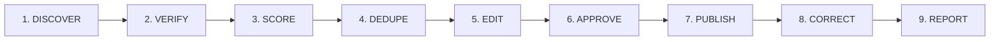

# EkoCC LIVE CONTENT V3 — TREND RADAR + CC INSIDE
**Data:** 2026-10-30 | **Odbiorca:** Antigravity Automations | **Status:** Specyfikacja wdrożeniowa ekosystemu Christian Culture

---

## 1. MISJA I FUNDAMENT OPERACYJNY
Stwórz trwały, stale aktywny system REDAKCYJNY, który wyszukuje, weryfikuje, redaguje i publikuje czytelne, przystosowane do TTS materiały na istniejących portalach EkoCC. 
NIE jest to projekt automatyzacji całego zaplecza, emisji radia ani obsługi infrastruktury. Priorytetem jest to, co odbiorca widzi, czyta i słucha. 
Stosuj **ZERO COST**, istniejące narzędzia i centralny rejestr agentów. 
Nie zakładaj, że publikowanie lub integracje już działają: **SPRAWDŹ**.

---

## 2. DWA FILARY SYSTEMU

### A. TREND RADAR (Świat → Materiały)
Monitoruj wiarygodne źródła dotyczące 10 kluczowych obszarów życia:
1. Wojna, pokój, bezpieczeństwo i kryzysy humanitarne,
2. AI i nowe technologie,
3. Polska i świat,
4. Polityka i społeczeństwo (neutralna relacja faktograficzna),
5. Gospodarka, praca i finanse/biznes,
6. Zdrowie i medycyna (konsensus naukowy, bez zastępowania leczenia),
7. Rodzina i relacje (małżeństwo, wychowanie dzieci),
8. Kuchnia i zdrowy styl życia,
9. Kultura i muzyka,
10. Wiara, religia i edukacja biblijna.

**Zasady źródeł i rzetelności:**
- Źródła: oficjalne komunikaty, agencje informacyjne, instytucje, specjalistyczne serwisy i wiarygodne media; zachowaj URL, czas publikacji, datę zdarzenia i moment weryfikacji.
- Kanały pobierania: RSS/Atom, publiczne API, strony oficjalne zgodnie z licencjami i `robots.txt`.
- Kategoryczny zakaz kopiowania cudzych artykułów (plagiatu).
- W konfliktach bezwzględnie rozdzielaj twierdzenia stron, doniesienia i niezależnie potwierdzone fakty.
- Dla aktualności o wysokim ryzyku wymagane **minimum 2 niezależne źródła**. Przy braku drugiego źródła oznacz jako „nieweryfikowane” i wstrzymaj publikację.
- Kategoryczny zakaz spekulowania o liczbie ofiar lub rzucania niesprawdzonych oskarżeń.

### B. CC INSIDE (EkoCC → Autopromocja)
Skanuj wyłącznie faktyczne, autoryzowane źródła EkoCC: CMS-y, repozytoria, RSS, kanały, archiwum publikacji, katalog projektów, ramówki i metadane materiałów.
- **Wykrywaj:** nowe artykuły, audycje, podcasty, utwory muzyczne, premiery, transmisje LIVE, wydarzenia, książki, audiobooki, lekcje Akademii, narzędzia (wyszukiwarka, AI dla Jezusa), BCM24, portal LUMINA i inicjatywy wsparcia misji.
- **Twórz:** atrakcyjne, merytoryczne zapowiedzi, wywiady redakcyjne na podstawie zatwierdzonych wypowiedzi Cezarego i Wioletty Rogowskich, przeglądy tygodnia, polecenia archiwalne i aktualizacje projektów.
- **Wymóg prawdy:** Każdy materiał musi wskazywać konkretną istniejącą stronę docelową i faktyczny status (`dostępne` / `zapowiedziane` / `w rozwoju`).
- **Żelazny zakaz:** Nigdy nie ogłaszaj premiery, działania funkcji ani wyników bez faktycznego potwierdzenia.

---

## 3. HARMONOGRAM I CZĘSTOTLIWOŚĆ (Sprawdzanie to NIE publikowanie)
*Godziny w strefie `Europe/Warsaw`.*

- **Co 15 min:** Monitoring breaking news (wojny, Polska, świat, AI), wykrywanie i deduplikacja. Publikuj wyłącznie przy nowej, potwierdzonej informacji — nigdy mechanicznie co 15 minut.
- **Co 30–60 min:** Analiza innych kategorii i trendów; aktualizuj już opublikowany artykuł, gdy zmieniają się istotne fakty, z widocznym datownikiem i historią korekt.
- **Co 60 min:** Wykrywanie rzeczywistych nowości Christian Culture (CC INSIDE).
- **2 razy dziennie:** Pomysły na przekrojowe materiały CC INSIDE, z linkami do źródeł.
- **Codziennie:** 1–3 zatwierdzone artykuły evergreen (Biblia, rodzina, kuchnia, edukacja, technologie, zdrowie) i maks. kilka autopromocyjnych, zależnie od tego, czy są aktualne fakty do opisania.
- **Tygodniowo:** Kalendarz premier EkoCC, przegląd najważniejszych wydarzeń i treści, przegląd skuteczności/duplikatów.

> ⚠️ Natywna automatyzacja Antigravity może mieć opóźnienia i limity; przy braku obsługi interwału 15 min zastosuj niezawodny zewnętrzny scheduler dopiero po zgodzie, bez ukrytych kosztów. Nie uruchamiaj skanowania ani publikacji w pętli bez limitów.

---

## 4. STANDARD MATERIAŁU (WWW + TTS)
Każdy artykuł musi posiadać kompletne pola strukturalne:
- `id`: Unikalny identyfikator (np. `art-2026-10-30-gdy-lek-o-jutro`),
- `canonical_url`: Potwierdzony, pełny adres URL (np. `https://polskieradio.cc/news/...`),
- `category`: Jedna z 10 kategorii tematycznych,
- `topic`: Zwięzły temat / słowo przewodnie,
- `title`: Prawdziwy, przyciągający, niewygórowany nagłówek H1,
- `lead`: Esencjonalne 2–3 zdania wprowadzające,
- `content`: Treść podzielona na krótkie, logiczne akapity (2–4 zdania każdy),
- `author`: Cezary Rogowski, Wioletta Rogowska lub Redakcja CCN z oznaczeniem ewentualnego udziału AI,
- `sources`: Tablica wiarygodnych źródeł z pełnymi odnośnikami URL i datami,
- `published_at`: Znacznik czasu ISO 8601,
- `updated_at`: Znacznik czasu ostatniej weryfikacji/aktualizacji,
- `language`: `pl` (lub `en` dla serwisu globalnego),
- `tts_text`: Czysty tekst dla lektora TTS (rozwinięte skróty, naturalnie zapisane liczby i daty, brak opisów UI i czytania URL-i znak po znaku),
- `seo_description`: Precyzyjny meta description pod kątem wyszukiwarek,
- `status`: `draft` / `approved` / `published` / `archived`,
- `next_step_link`: Potwierdzony, działający link do kolejnego kroku lub powiązanej treści EkoCC.

**Zasada TTS ZERO COST:**
Umożliwiaj czytanie i słuchanie bez generowania płatnego pliku audio: korzystaj z istniejącego Web Speech API w przeglądarce lub wbudowanej integracji.

---

## 5. KONTEKST CHRZEŚCIJAŃSKI I ETYKA
- **Rozdział faktów od komentarza:** Biblijna refleksja jest opcjonalna, relewantna i wyraźnie oddzielona od faktograficznego opisu zdarzeń.
- **Tragedie i wojna:** Zakaz dopisywania cytatów ani proroctw do bieżących dramatów wojennych; nie traktuj ludzkiego cierpienia jako clickbaitu.
- **Polityka:** Neutralna, bezstronna relacja faktograficzna, bez popierania jakichkolwiek partii politycznych czy kandydatów.
- **Medycyna:** Respektuj konsensus badań naukowych; nigdy nie przedstawiaj modlitwy ani wiary jako zamiennika profesjonalnego leczenia czy ratownictwa.
- **Biblia i cytaty:** Wyłącznie autoryzowany przekład **UBG (Uwspółcześniona Biblia Gdańska)** z dosłownym sprawdzeniem wersetów i kontekstu księgi.

---

## 6. 9-STOPNIOWY PIPELINE PUBLIKACYJNY

1. **DISCOVER:** Pobierz tytuł, link, legalnie dostępną treść, datę i źródło.
2. **VERIFY:** Oceń wiarygodność, ważność, konflikt interesów i aktualność; min. 2 źródła dla newsów.
3. **SCORE:** Priorytet = znaczenie dla ludzi + aktualność + zgodność z działem + wartość edukacyjna.
4. **DEDUPE:** Jeden kanoniczny materiał na zdarzenie; rozwijaj zamiast duplikować.
5. **EDIT:** Artykuł oryginalny, jasny, TTS-ready, z przypisanymi źródłami.
6. **APPROVE:** **Faza pilotażu = wyłącznie szkice do zatwierdzenia przez Dowódcę.** Automatyczna publikacja dopiero w kolejnych fazach po testach.
7. **PUBLISH:** Atomowy zapis, unikalny `idempotency_key`, log publikacji, sprawdzony kod 200 OK.
8. **CORRECT:** Historia korekt z datownikiem, szybka ścieżka wycofania w razie błędu.
9. **REPORT:** Mierzalny rejestr wykrytych tematów, szkiców, publikacji i weryfikacji.

---

## 7. SZEŚĆ AUTOMACJI DO UTWORZENIA
1. `EkoCC • TREND RADAR • 15M`
2. `EkoCC • TOPICS DESK • HOURLY`
3. `EkoCC • CC INSIDE • HOURLY`
4. `EkoCC • DAILY EDITION`
5. `EkoCC • WEEKLY CULTURE REVIEW`
6. `EkoCC • EDITORIAL QA`

---

## 8. KRYTERIA ODBIORU PILOTAŻU
- **Dni 1–3:** Audyt i konfiguracja źródeł bez publikacji na żywo.
- **Dni 4–7:** Szkice 3 redakcji (CCN, AI, CC INSIDE) do wglądu i zatwierdzenia.
- **Wskaźniki sukcesu:**
  - 0 wymyślonych premier, funkcji i adresów URL,
  - Brak niezweryfikowanych breaking newsów w publikacji,
  - Pełna historia źródeł w każdym dokumencie,
  - Zero zdublowanych artykułów,
  - Każde wydanie przystosowane do czytania i odsłuchu TTS (Web Speech API),
  - Raport kosztów = **0,00 zł** (ZERO COST).
